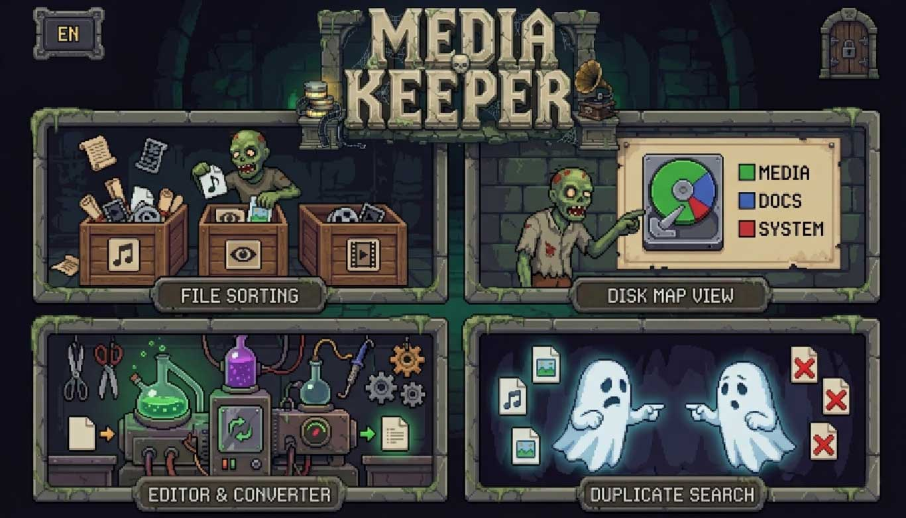
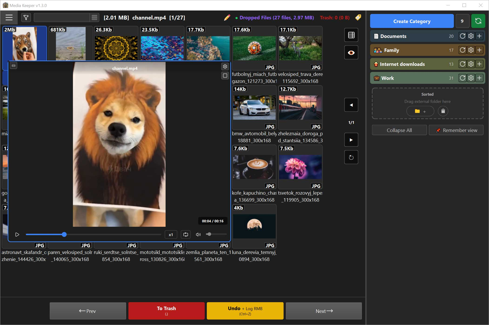
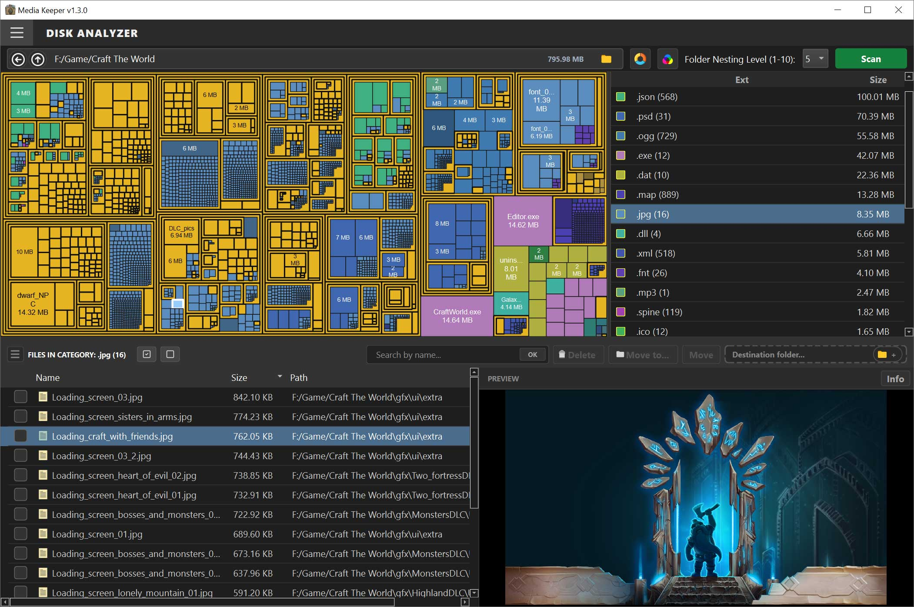
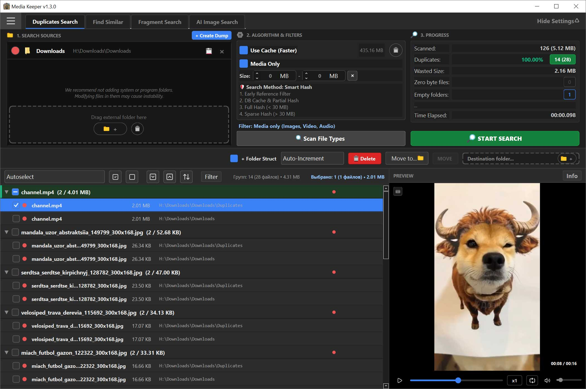
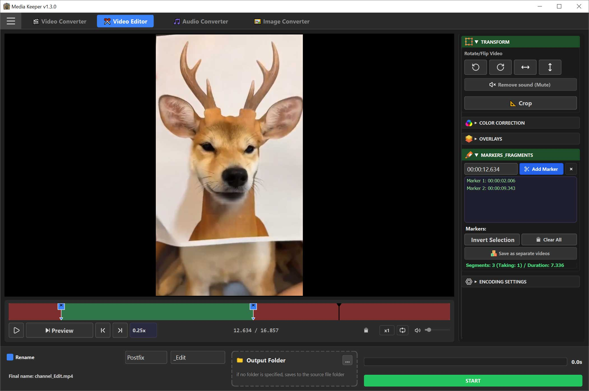

# Media Keeper 📂✨

[](https://github.com/scenthron/Media-Keeper/releases)
[](https://github.com/scenthron/Media-Keeper)
[](https://www.python.org/)
[-41cd52?style=for-the-badge&logo=qt)](https://www.qt.io/)
[](https://github.com/scenthron/Media-Keeper)

*[🇷🇺 Русский](README_ru.md) | 🇬🇧 English*

**An offline all-in-one tool for sorting media, analyzing disk space, safely finding duplicates and processing files with local AI.**

**Media Keeper** is a single control center for your local media archive (photos, videos, audio, documents). It covers the full range of routine tasks: from tidying up terabytes of scattered folders and finding hidden duplicates to local face recognition with neural networks, frame-accurate video editing and gentle repair of damaged files. All of it is packed into a stylish, responsive interface with no cluttered menus and no hidden subscriptions.

---

## 💎 Key Features

* **🔐 100% Privacy and Local AI (Zero Cloud / No Spyware):**
  * The app works **without an internet connection**: all file operations are performed only on your computer. Internet is needed only once — on your button press — to download the neural networks and FFmpeg. After that the app does not use the network.
  * Built-in neural networks (**SCRFD** for face detection, **ArcFace** for face recognition, **CLIP / M-CLIP** for semantic image search by text) run **locally** with **DirectML (GPU)** or CPU acceleration. No clouds, no telemetry or logs sent anywhere, and your personal photos are never shared with third parties!
* **⚡ Convenient, lively interface (TITAN design system):**
  * Deep dark theme with carefully tuned contrast and ergonomics.
  * End-to-end **Drag & Drop** for instantly adding folders and files.
  * Fully customizable hotkeys to speed up sorting.
* **🛡️ Uncompromising data safety:**
  * **Iron N-1 rule:** the app physically will not let you delete all copies of a found duplicate — at least one file (the "survivor") always stays safe.
  * **Move Journal:** a journal of the last 10 actions with safe step-by-step or batch rollback (`Ctrl + Z`).
  * Full support for **Windows Long Paths (`\\?\`)**: no failures or errors with extremely deep folder nesting.
* **🔌 Portable:**
  * The app does not need to be installed into the Windows registry and can run from any external drive or USB stick.
* **🔇 Peace and comfort:**
  * All pop-up messages and hints are completely silent — no annoying harsh Windows sounds.

---

## 🖥️ Main Screen (Launcher) and Unified Settings


* **⚙️ Centralized "Global Settings and Cache Manager" window:**
  * **Cache management:** a clear overview of database sizes on disk. If the cache has grown, it can be cleared in one click right from the table.
  * **AI and video codec control:** GPU status (hardware DirectML or CPU), a check for neural networks and FFmpeg, with the ability to quickly download them when needed.
  * **Hotkeys:** a separate convenient tab for configuring shortcuts to your habits.

---

## 🛠️ Main Modules

```
Media Keeper
 ├── 🚀 Launcher                     — Start window with quick-access buttons and language switch
 ├── 📂 Sorter                       — Grid, Canvas, Hover Preview, Move Journal, Affixes, Auto-rules
 ├── 📊 Disk Analyzer                — Squarified TreeMap, Sunburst, Export selection to Sorter
 ├── 🔍 Cleaner & AI                 — Exact duplicates, N-1 Protection, Face/Text search, Fragment search
 └── 🎬 Editor & Converters          — Video editing (Crop/Blur), Video/Audio/Image converters, Image repair
```

---

### 1. 📂 Media Sorter
An intelligent workspace for quickly sorting folders with mixed content ("Downloads", phone files, photo shoot archives). Lets you browse, pick and distribute files into target folders with a single mouse click or hotkey.

* **Workflow:** Choose a source folder (Inbox) ➡️ Build a tree of target folders ➡️ Assign a trash folder ➡️ Sort content with one click.
* **Key features:**
  * **High speed:** switching files with arrow keys and clicks is fast even in huge folders. Heavy photo previews are optimized so the interface stays smooth and responsive.
  * **3 convenient view modes with unified hints:**
    * *Grid View:* a smooth grid with instant zoom using the mouse wheel (`Ctrl + wheel`).
    * *List View:* a detailed table with sizes, types and dates, plus a quick built-in preview window.
    * *Solo Canvas:* a comfortable full-screen canvas for detailed review of photos, videos and audio playback.
  * **Advanced quick view (Hover Preview) in Grid View:**
    * A pop-up preview when hovering over a tile, without clicking or opening the file.
    * **Playback speed memory:** the chosen viewing/listening speed (1.25x, 1.5x, 2.0x) is kept for the whole work session for quick review of media and podcasts.
  * **Move Journal & transactional Undo:**
    * Quick rollback of the last action with `Ctrl + Z`.
    * A full Move Journal window (opened by right-clicking the undo button): a table with the history of the last 10 operations per session, color-coded statuses (green — file in place, red — moved or deleted outside the program), jump to the file by double click and to the folder by middle click.
  * **Virtual Folders:** seamlessly accept file lists dragged from the system, as well as from the Disk Analyzer, or duplicates found in the Cleaner, for visual manual sorting.
  * **Affix panel and smart renaming:** batch adding of prefixes, suffixes, tags and dynamic date/time labels to a selected group of files, with a transactional Dry Run simulation for complete protection from name conflicts.
  * **Folder tree personalization:** the expanded/collapsed state of branches is saved in `.mediakeeper/treeview.json`; choose individual folder icons from the built-in collection and use color coding for categories.
  * **Format versatility:** support for rare and modern formats, including `.flv`, `.heic`, `.avif`, `.webp` (static and animated), `.tiff`, `.gif`, `.opus` and more.



---

### 2. 📊 Disk Space Analyzer
A clear, interactive map of disk usage that helps you find hidden space hogs on your drives within seconds.

* **Workflow:** Choose a drive or folder to scan ➡️ The app instantly builds an interactive map ➡️ Explore nested structures and send heavy folders to cleaning or sorting in one click.
* **Key features:**
  * **Two interactive chart modes:**
    * *TreeMap:* the *Squarified Treemap* algorithm showing folder proportions as tightly packed rectangles (enabled by default).
    * *Sunburst:* radial rings for a clear view of subfolder nesting depth.
  * **Central interactive overlay:** quick navigation buttons (Back, Up one level) and instant display of the current folder's path and size in the center of the screen.
  * **Quick zoom control:** change analysis depth with a combo box or simply by rotating the mouse wheel over the chart. A button for quickly generating a new contrasting color palette.
  * **Dual synchronized detail view:** the right summary panel groups files by type/extension, while the bottom table shows specific files sorted by size.
  * **Seamless Sorter integration:** select heavy files or a whole folder and send them to the Sorter module as a virtual folder for interactive review in one click.
  * **Contextual analysis:** jump to a deep analysis of the parent directory of any selected file via right click.



---

### 3. 🔍 Cleaner, Duplicate Finder and Local AI
A universal media library cleanup center combining strict exact-comparison algorithms, detection of damaged files and neural-network AI that works 100% locally.

```
Cleaner module tabs
 ├── 📑 Duplicates & Similar        — Exact duplicates (MD5/SHA256), Similar (pHash/dHash/Audio/Video), N-1 Protection
 ├── 🧩 Fragment Search (ORB/SIFT)  — Find matches by a cropped piece/logo
 └── 👥 AI Search (AI Tab)          — Face search (SCRFD+ArcFace), References, Text search (CLIP)
```

* **A. Classic Duplicate Finder:**
  * **🛡️ Iron-clad N-1 rule ("Survivor"):** a unique protection mechanism that prevents accidental data loss. The interface and the database block marking all files in a group — at least one original file is guaranteed to remain untouched.
  * **Smart hashing:** instant size checks, *Sparse Hashing* for massive video files over 30 MB, and exact checksums (MD5/SHA256).
  * **Reference folders:** designate trusted master folders whose files act only as samples and are protected from any changes.
  * **Hash dump files:** create lightweight dump files without the original media to quickly check new folders against ready-made fingerprints.
  * **Junk cleanup:** find damaged (0-byte) files and empty folders.
  * **Safe transfer:** move duplicates to a quarantine folder while fully preserving the original subfolder tree so they can be returned without a trace.

* **B. Similar Media Finder:**
  * **Similar images:**
    * Three proven perceptual hashing algorithms:
      * **pHash (Perceptual):** analyzes the frequency spectrum of the frame via the discrete cosine transform (DCT). Ideal for images with text, logos and watermarks, avoiding false positives.
      * **dHash (Difference):** ultra-fast comparison of brightness gradients between neighboring pixels. Excellent at finding compressed, re-saved and resized copies of the same photo.
      * **aHash (Average):** a simple and fast hash based on average brightness.
    * **Adjustable precision:** choose an analysis grid from 8x8 to 64x64 (hashes from 64 to 4096 bits to catch the smallest differences).
    * **Monotone collision filter:** frame contrast analysis that prevents uniform screenshots, monotone backgrounds and white pages from being wrongly merged into one group.
  * **Similar audio:**
    * Acoustic spectral fingerprinting (*Acoustic Fingerprinting* based on `fpcalc` / Chromaprint). Finds identical tracks regardless of bitrate, encoding format (MP3, FLAC, AAC, WAV, OGG) and volume level.
  * **Similar video:**
    * Hashing of control keyframes (1, 3, 5 or 10 frames). Detects re-compressed clips, videos with a different resolution or trimmed duration.
  * **Flexible similarity control:**
    * A similarity threshold slider (70% to 100%) with arrows for fine adjustment in hundredths of a percent.
    * **Smart Autoselect:** automatically marks the worst copies by configurable rules (keep the highest resolution, larger bitrate/size, shallowest path nesting or the newest file).

* **C. 100% Local AI Image Search:**
  * **Two result view modes:** switch between a detailed tree list and a clear **thumbnail grid** with large cards, similarity percentage badges and convenient hover quick view.
  * **People and face recognition:** smart face and portrait search based on **SCRFD** and **ArcFace** neural networks with fine sensitivity tuning and face highlighting with frames.
  * **Clean grouping:** the algorithm merges similar faces of one person and neatly separates different people into separate groups.
  * **Search by reference groups:** create your own reference collections with examples of "who to look for" and "who to exclude".
  * **Semantic text search (CLIP / M-CLIP):** find photos by an ordinary human description (*"sunset at the sea"*, *"black cat on a sofa"*, *"party with friends"*) right on your computer without internet.
  * **Smart search without references:** automatic layout of your whole photo collection by people or scenes.
  * **Instant repeat searches:** analysis results are reliably saved to a local cache, so a repeated search over previously scanned folders opens immediately.

* **D. Fragment Search:**
  * Crop any rectangular piece of an image right in the program (a logo, a detail, a meme, a face) or load a ready sample.
  * Smart keypoint matching algorithms (**ORB** and **SIFT**) will find all matches in the library, even if the frame was scaled down, rotated or compressed.

* **E. Seamless Sorter integration (Virtual Folders):**
  * Any group of duplicates or similar files can be sent to the Sorter in one click as a virtual folder for convenient visual comparison on the canvas or in the tile grid.



---

### 4. 🎬 Video Editor and Multi-Converter
A multifunctional studio for frame-accurate video processing and batch conversion of any media files.

#### 🎥 Interactive Video Editor:
* **Instant preview:** real-time rendering of changes based on the native engine.
* **Geometric transformation:** free cropping (Crop) with aspect ratio lock, rotation by 90°/180°/270°, horizontal and vertical mirroring.
* **Color correction:** fine adjustment of exposure, contrast, saturation and gamma.
* **Overlays:**
  * Blur with adjustable intensity for censoring faces, license plates or personal data.
  * Color bars and watermarks (adding PNG/JPG logos with control of transparency and position).
* **Editing timeline:** precise placement of fragment markers for cutting video into segments or removing defective frames.
* **Labels and animated watermarks:** quickly add marker images to a video with a VHS bounce effect and configurable speed and movement type. Lets content creators mark exclusive content without resorting to complex software.

#### 🔄 Batch Converters:
* **Video converter:**
  * Codecs: H.264, H.265 (HEVC), MPEG-4.
  * Containers: MP4, MKV, MOV, WebM, FLV.
  * **Smart compression to a limit:** automatic bitrate calculation to fit a video into a strict file size limit (for example, 8 MB or 25 MB for sending via Telegram/Discord) without losing picture legibility.
* **Audio converter:**
  * Support for MP3, AAC, FLAC, WAV, OGG, OPUS.
  * Constant (CBR) and variable (VBR) bitrate control, sample rate adjustment.
  * Extract audio tracks from any video file in one click.
* **Advanced Image Converter & Repair:**
  * *"Convert" tab:*
    * Batch resize and format change (PNG, JPG, WebP, BMP, TIFF).
    * Fine quality tuning and intelligent compression to a target file size in MB with a "Quality vs Resolution" balance slider.
    * Full support for **animated GIF and WebP**: keeping loops, individual frame delays and algorithmic color palette optimization (256 ➔ 16 colors).
  * *"Repair" tab:*
    * **Magic Bytes auto-diagnostics:** instant detection of files with fake extensions (for example, a downloaded WebP manually renamed to JPG).
    * **Removing Windows system locks:** detection of hidden `Zone.Identifier` security streams (blocking of files from the internet) and `FILE_ATTRIBUTE_TEMPORARY` attributes. Unlock the whole table in one click ("🔓 Remove locks and attributes").
    * **3 repair modes:**
      1. *"Fix extension to match format (Lossless)" (default):* byte-exact renaming or copying of the extension to match the real container type **without re-encoding the pixel matrix** (100% preservation of original quality).
      2. *"Re-encode to the correct format":* full re-encoding to the target format with adaptive bitrate and smart skipping of correct files.
      3. *"Restore EXIF thumbnails":* direct lossless injection of a valid preview thumbnail (APP1/IFD1) into the JPEG header via `piexif` for instant thumbnail display in Windows Explorer.
    * Batch extension change for the selected list.
    * Safe-save mode with automatic collision indexing (`_1`, `_2`).
    * Compact display of long names in the table using `MiddleElideDelegate`.



---

## 🛠️ Tech Stack

* **Core and GUI:** Python 3.10+, PyQt6 (Qt 6.7+).
* **Computer vision and AI:** OpenCV, ONNX Runtime (DirectML / CPU), InsightFace (SCRFD, ArcFace), CLIP / M-CLIP.
* **Multimedia engine:** FFmpeg (libavcodec, libavformat, swscale).
* **Graphics processing:** Pillow (PIL), piexif.
* **Database and cache:** SQLite3 with protected integrity triggers.
* **File system:** a custom fault-tolerant I/O layer `utils_io.py` with Windows Long Paths (`\\?\`) support.

---

## 📥 Download and Run (for users)

1. Open the [Releases](https://github.com/scenthron/Media-Keeper/releases) page and download the latest ZIP archive.
2. Unpack the archive into any folder (or onto a USB stick — the program is portable).
3. Run the `.exe` file from the archive. No installation is required.
4. On first launch the program will offer to download FFmpeg and the neural networks — this is the only thing that requires internet.

---

## 🚀 Installation and Launch (for developers)

### System requirements
* Operating system: **Windows 10 / 11** (64-bit).
* Python: version **3.10** or higher.
* A graphics card with **DirectX 12** support (for hardware neural network acceleration via DirectML) or a modern multi-core CPU.
* **FFmpeg:** required for the video and audio modules. On first launch the program automatically detects its absence and offers to download and install a build into the `.mediakeeper/bin/` directory in one click.

### Step-by-step instructions
1. Clone the repository:
   ```bash
   git clone https://github.com/scenthron/Media-Keeper.git
   cd Media-Keeper
   ```
2. Create and activate a virtual environment:
   ```bash
   python -m venv venv
   venv\Scripts\activate
   ```
3. Install the required dependencies:
   ```bash
   pip install -r requirements.txt
   ```
4. Launch the app via the built-in manager script:
   ```bash
   python run.py
   ```
   *(The `run.py` script automatically checks component integrity and runs basic auto-tests before opening the main window).*

---

## 📦 Building an Executable (.exe)

A standalone version is built with the optimized `build.py` script based on PyInstaller:

```bash
python build.py
```
The script automatically packs the required libraries, DirectML dependencies, styles and Qt SVG plugins. The finished distribution will be generated in the `dist/` directory.

---

## 🤖 Automatic Cloud Build (CI/CD)

A **GitHub Actions** pipeline is configured in the repository (file [.github/workflows/build.yml](.github/workflows/build.yml)):
* **Test build:** runs automatically on every push to the `main` branch. The compiled artifact can be tested in the **Actions** tab.
* **Releases:** when a version tag is created, the robot automatically compiles a clean Windows distribution, packs it into a ZIP archive and attaches it to the publication in the [Releases](https://github.com/scenthron/Media-Keeper/releases) section.

---

## 📜 Project History and Philosophy

**Media Keeper** grew out of a real need to put huge archives of photos, videos and work materials in order. Most existing programs either required an expensive subscription, sent personal photos to someone else's cloud servers, or had a complicated, cluttered interface from the early 2000s.

The emergence of modern open neural networks and the AI assistant **Google Antigravity** allowed the author (who is not a professional developer) to turn scattered automation scripts into a complete, cohesive, industrial-grade software product.

The visual style and atmosphere of the project are inspired by the author's love for the wonderful game **Graveyard Keeper** — putting files in order can be not a dreary chore, but a pleasant and aesthetic process!

---

## ⚖️ License

The project is distributed under the author's own license **"MIT with Non-Commercial Restriction"**. This is **not the classic MIT** license and is not an open-source license in the OSI sense: commercial use is prohibited.

You may freely study the source code, modify it and use the program for personal purposes, provided attribution is kept. Commercial distribution of the program or its parts without the author's written consent is strictly prohibited. See the [LICENSE](LICENSE) file for details.

---

## 📬 Contact the Author

* 💬 GitHub Issues: [Report a bug or suggest an idea](https://github.com/scenthron/Media-Keeper/issues)
* 💬 Discord: `Centhron`
* 📧 E-mail: media.keeper.fb@gmail.com

### ☕ Support the author financially:
* **DonationAlerts:** https://dalink.to/centhron_s
* **Boosty:** https://boosty.to/centhron

---
*Huge thanks to all friends for beta testing, valuable feedback and inspiration, and to Google for Antigravity and the Gemini models!* 🚀
