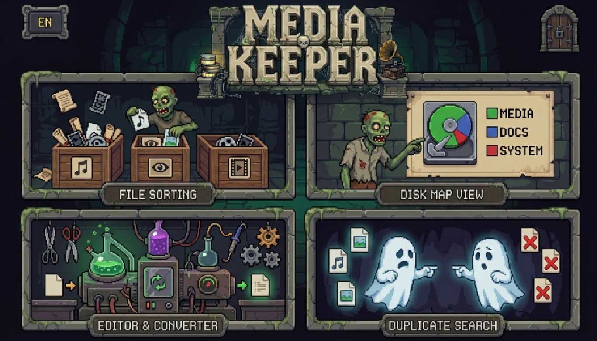
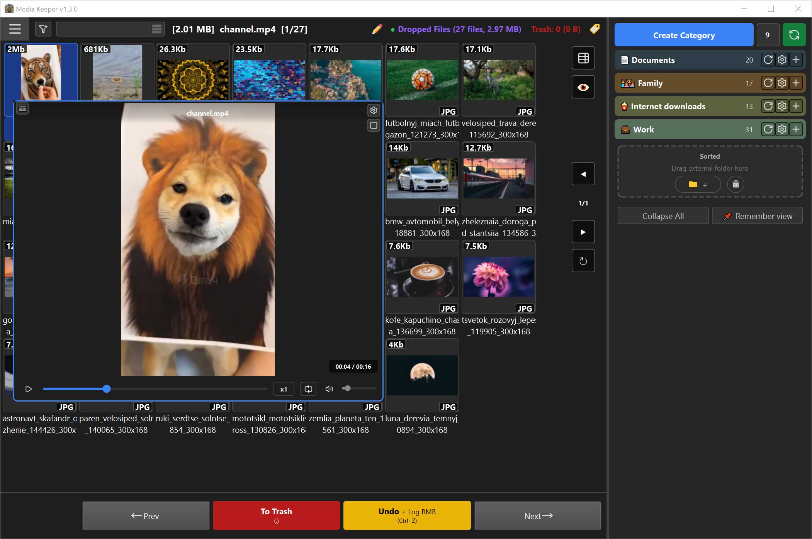
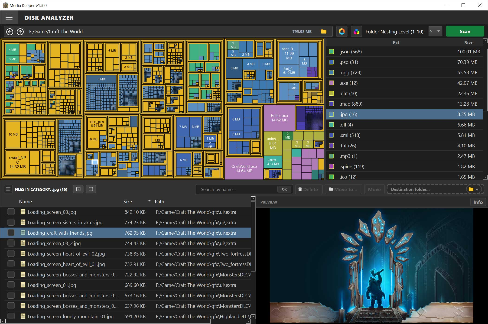
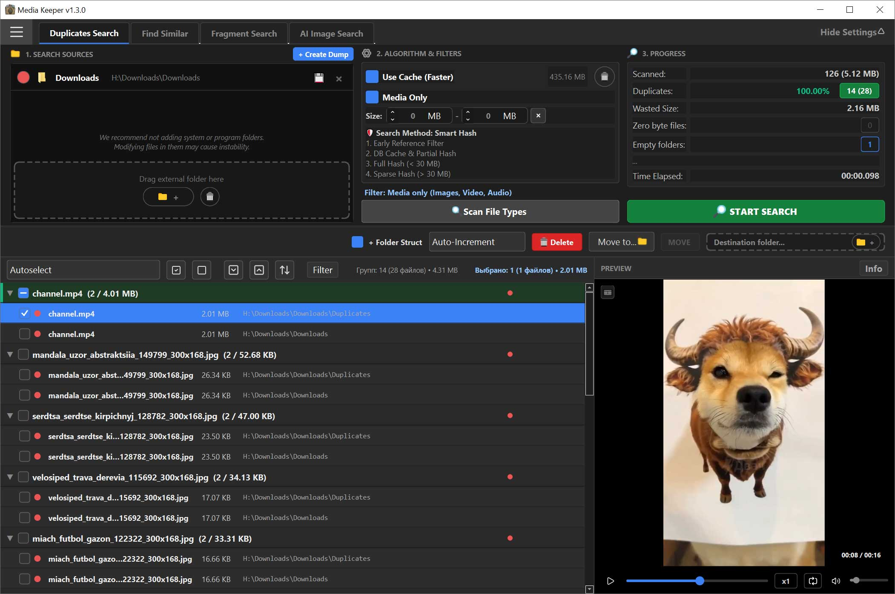
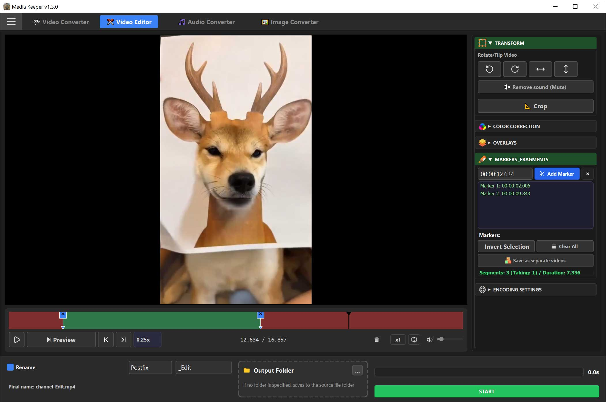

# Media Keeper 📂✨

[](https://github.com/scenthron/Media-Keeper/releases)
[](https://github.com/scenthron/Media-Keeper)
[](https://www.python.org/)
[-41cd52?style=for-the-badge&logo=qt)](https://www.qt.io/)
[](https://github.com/scenthron/Media-Keeper)

*🇷🇺 Русский | [🇬🇧 English](README.md)*

**Офлайн-комбайн для сортировки медиа, анализа диска, безопасного поиска дубликатов и обработки файлов с локальным ИИ.**

**Media Keeper** — это единый центр управления вашим локальным медиаархивом (фотографии, видео, аудио, документы). Программа решает полный спектр рутинных задач: от наведения порядка в терабайтах разрозненных папок и нахождения скрытых дубликатов до локального распознавания лиц нейросетями, покадрового монтажа видео и бережного восстановления поврежденных файлов. Всё это упаковано в стильный, отзывчивый интерфейс без перегруженных меню и скрытых подписок.

---

## 💎 Главные особенности

* **🔐 100% Конфиденциальность и Локальный ИИ (Zero Cloud / No Spyware):**
  * Программа работает **без подключения к интернету**: все операции с файлами производятся исключительно на вашем компьютере. Интернет нужен только один раз — по вашей кнопке, чтобы скачать нейросети и FFmpeg. После этого сеть программой не используется.
  * Встроенные нейросети (**SCRFD** для детекции лиц, **ArcFace** для распознавания биометрии, **CLIP / M-CLIP** для семантического поиска картинок по тексту) функционируют **локально** с аппаратным ускорением **DirectML (GPU)** или CPU. Никаких облаков, отправки телеметрии, логов или передачи ваших персональных фото третьим лицам!
* **⚡ Удобный и живой интерфейс (дизайн-система TITAN):**
  * Глубокая тёмная тема с выверенной контрастностью и эргономикой.
  * Поддержка сквозного **Drag & Drop** для мгновенного добавления папок и файлов.
  * Полная кастомизация горячих клавиш для ускорения сортировки.
* **🛡️ Бескомпромиссная безопасность данных:**
  * **Железное правило безопасности N-1:** программа физически не позволит удалить все копии найденных дубликатов — минимум один файл («выживший») всегда останется в безопасности.
  * **Журнал перемещений (Move Journal):** журнал 10 последних действий с возможностью безопасного пошагового или пакетного отката (`Ctrl + Z`).
  * Полная поддержка **длинных путей Windows (Long Paths `\\?\`)**: исключены сбои и ошибки при работе со сверхглубокой вложенностью папок.
* **🔌 Портативность (Portable):**
  * Приложение не требует установки в реестр операционной системы и может работать с любого внешнего накопителя или флешки.
* **🔇 Тишина и комфорт:**
  * Все всплывающие сообщения и подсказки работают полностью бесшумно, без раздражающих резких звуков Windows.

---

## 🖥️ Главный экран (Лаунчер) и Единые настройки


* **⚙️ Централизованное окно «Глобальные настройки и Менеджер кэша»:**
  * **Управление кэшем:** наглядный обзор веса баз данных на диске. Если кэш разросся, его можно легко очистить в один клик прямо из таблицы.
  * **Контроль ИИ и видеокодеков:** статус работы видеокарты (аппаратный DirectML или процессор), проверка наличия нейросетей и FFmpeg с возможностью быстро скачать их при необходимости.
  * **Горячие клавиши:** отдельная удобная вкладка для настройки быстрых клавиш под ваши привычки.

---

## 🛠️ Основные модули программы

```
Media Keeper
 ├── 🚀 Лаунчер (Launcher)          — Стартовое окно с кнопками быстрого перехода и сменой языка
 ├── 📂 Сортировщик (Sorter)          — Плитка, Холст, Hover Preview, Move Journal, Аффиксы, Авто-правила
 ├── 📊 Анализатор диска (Analyzer)    — Squarified TreeMap, Sunburst, Экспорт выборки в Сортировщик
 ├── 🔍 Очиститель и ИИ (Cleaner)     — Точные дубликаты, N-1 Защита, Поиск по лицу/тексту, Поиск фрагментов
 └── 🎬 Редактор и Конвертеры (Editor) — Видеомонтаж (Crop/Blur), Конвертеры Видео/Аудио/Изображения, Восстановление картинок
```

---

### 1. 📂 Сортировщик Медиафайлов (Sorter)
Интеллектуальный рабочий стол для быстрой разборки папок со смешанным контентом («Загрузки», файлы с телефонов, архивы съемок). Позволяет просматривать, отбирать и раскладывать файлы по целевым каталогам в один клик мыши или по нажатию горячей клавиши.

* **Воркфлоу:** Выбираете папку-источник (Inbox) ➡️ Формируете дерево целевых каталогов ➡️ Назначаете папку для мусора ➡️ Сортируете контент в один клик.
* **Ключевые возможности:**
  * **Высокая скорость:** переключение файлов стрелочками и кликами происходит быстро даже в огромных папках. Предпросмотр тяжелых фотографий оптимизирован, чтобы интерфейс оставался плавным и отзывчивым.
  * **3 удобных режима отображения с едиными подсказками:**
    * *Сетка плиток (Grid View):* плавная сетка с мгновенным масштабированием колесиком мыши (`Ctrl + колесо`).
    * *Таблица (List View):* подробная таблица с размерами, типами и датами, а также быстрым встроенным окном предпросмотра.
    * *Одиночный просмотр (Solo Canvas):* комфортный полноэкранный холст для детального разбора фотографий, видео и прослушивания аудио.
  * **Продвинутый быстрый просмотр (Hover Preview) в режиме Сетка плиток (Grid View):**
    * Всплывающее окно предпросмотра при наведении курсора на плитку без необходимости кликать и открывать файл.
    * **Сохранение скорости воспроизведения:** выбранная скорость просмотра/прослушивания (1.25x, 1.5x, 2.0x) сохраняется на протяжении всей рабочей сессии для быстрой ревизии медиаматериалов и подкастов.
  * **Журнал перемещений и транзакционный откат (Move Journal & Undo):**
    * Быстрый откат последнего действия по нажатию `Ctrl + Z`.
    * Полноценное окно Журнала перемещений (вызывается по правому клику мыши на кнопке отката): таблица с историей 10 последних операций за сессию, цветовая подсветка статусов (зеленый — файл на месте, красный — перемещен или удален вне программы), переход к файлу по двойному клику и к папке по среднему клику.
  * **Виртуальные сессии (Virtual Folders):** возможность бесшовно принимать списки файлов перемещением из системы, а также из Анализатора диска или найденные дубликаты из Cleaner для визуальной ручной сортировки.
  * **Панель аффиксов и умного переименования:** пакетное добавление префиксов, суффиксов, тегов и динамических меток даты/времени к выбранной группе файлов с предварительной транзакционной симуляцией (Dry Run) для абсолютной защиты от конфликтов имен.
  * **Персонализация дерева папок:** сохранение состояния развернутых/свернутых веток в `.mediakeeper/treeview.json`, выбор индивидуальных иконок для папок из встроенной коллекции и цветовое кодирование категорий.
  * **Всеядность форматов:** поддержка редких и современных форматов, включая `.flv`, `.heic`, `.avif`, `.webp` (статический и анимированный), `.tiff`, `.gif`, `.opus` и др.



---

### 2. 📊 Анализатор пространства диска (Analyzer)
Наглядная интерактивная карта использования дискового пространства, помогающая за считанные секунды обнаружить скрытые «пожиратели» места на ваших накопителях.

* **Воркфлоу:** Выбираете диск или папку для сканирования ➡️ Программа мгновенно строит интерактивную карту ➡️ Исследуете вложенные структуры и в один клик отправляете тяжелые каталоги на очистку или сортировку.
* **Ключевые возможности:**
  * **Два режима интерактивных диаграмм:**
    * *Плоская карта (TreeMap):* алгоритм *Squarified Treemap*, отображающий пропорции папок в виде плотно упакованных прямоугольников (включен по умолчанию).
    * *Круговая лучевая диаграмма (Sunburst):* радиальные круговые кольца для наглядной оценки глубины вложенности подпапок.
  * **Центральный интерактивный оверлей:** кнопки быстрой навигации (Назад, На уровень вверх) и мгновенное отображение пути и размера текущей папки по центру экрана.
  * **Быстрое управление масштабом:** изменение глубины анализа с помощью комбобокса или просто вращением колесика мыши над диаграммой. Кнопка быстрой генерации новой контрастной палитры цветов.
  * **Двойная синхронная детализация:** правая сводная панель группирует файлы по типам/расширениям, а нижняя таблица отображает конкретные файлы с сортировкой по весу.
  * **Сквозная интеграция с Сортировщиком:** возможность выделить тяжелые файлы или целую папку и в один клик отправить их в модуль Сортировщика как виртуальную папку для интерактивного разбора.
  * **Контекстный анализ:** переход к глубокому анализу родительской директории любого выбранного файла через правый клик мыши.



---

### 3. 🔍 Очиститель, Поиск дубликатов и Локальный ИИ (Cleaner)
Универсальный центр очистки медиатеки, объединяющий строгие алгоритмы точного сравнения, детекцию поврежденных файлов и нейросетевой искусственный интеллект, работающий на 100% локально.

```
Вкладки модуля Cleaner
 ├── 📑 Поиск дубликатов и Похожих  — Точные дубликаты (MD5/SHA256), Похожие (pHash/dHash/Аудио/Видео), N-1 Защита
 ├── 🧩 Поиск по фрагменту (ORB/SIFT) — Поиск совпадений по вырезанному кусочку/логотипу
 └── 👥 ИИ-Поиск (AI Tab)          — Поиск по лицам (SCRFD+ArcFace), Эталоны, Текстовый поиск (CLIP)
```

* **А. Классический поиск дубликатов (Duplicate Finder):**
  * **🛡️ Железобетонное правило N-1 («Выживший»):** уникальный защитный механизм, предотвращающий случайную потерю данных. Интерфейс и база данных блокируют отметку всех файлов в группе — как минимум один оригинальный файл гарантированно останется нетронутым.
  * **Умное хэширование:** мгновенная проверка размеров, разреженное хэширование (*Sparse Hashing*) для массивных видеофайлов свыше 30 МБ и точные контрольные суммы (MD5/SHA256).
  * **Эталонные папки:** возможность назначить доверенные мастер-папки, файлы из которых будут выступать только в качестве образцов и будут защищены от любых изменений.
  * **Файлы-дампы хэшей:** создание легковесных файлов-дампов без оригиналов медиа для быстрой проверки новых папок по готовым отпечаткам.
  * **Очистка мусора:** нахождение поврежденных файлов (0 байт) и пустых папок.
  * **Безопасный перенос:** перемещение дубликатов в карантинную папку с полным сохранением исходного дерева подпапок для возможности бесследного возврата.

* **Б. Поиск похожих медиафайлов (Similar Media Finder):**
  * **Похожие изображения:**
    * Три проверенных алгоритма перцептивного хэширования:
      * **pHash (Частотный / Perceptual):** анализирует частотный спектр кадра через дискретно-косинусное преобразование (DCT). Идеален для картинок с текстом, логотипами и водяными знаками, исключая ложные срабатывания.
      * **dHash (Градиентный / Difference):** сверхбыстрое сравнение перепадов яркости соседних пикселей. Превосходно находит сжатые, пересохраненные и масштабированные копии одной фотографии.
      * **aHash (Средний / Average):** простой и быстрый хэш по средней яркости.
    * **Регулируемая глубина точности:** выбор сетки анализа от 8x8 до 64x64 (хэши от 64 до 4096 бит для улавливания мельчайших различий).
    * **Фильтр монотонных коллизий:** анализ контрастности кадра, исключающий ошибочное склеивание однородных скриншотов, монотонных фонов и белых страниц в одну группу.
  * **Похожее аудио:**
    * Акустический спектральный отпечаток (*Acoustic Fingerprinting* на базе `fpcalc` / Chromaprint). Находит одинаковые композиции независимо от битрейта, форматов кодирования (MP3, FLAC, AAC, WAV, OGG) и уровня громкости.
  * **Похожее видео:**
    * Хэширование контрольных ключевых видеокадров (1, 3, 5 или 10 кадров). Позволяет обнаруживать пережатые ролики, видео с другим разрешением или обрезанным хронометражем.
  * **Гибкая регулировка сходства:**
    * Ползунок порога схожести (от 70% до 100%) со стрелочками точной подстройки в сотые доли процента.
    * **Умный автовыбор (Autoselect):** автоматическая пометка худших копий по настраиваемым правилам (сохранить максимальное разрешение, больший битрейт/размер, наименьшую глубину вложенности пути или самый свежий файл).

* **В. 100% Локальный ИИ-поиск изображений (Local AI Search):**
  * **Два режима просмотра результатов:** переключайтесь между подробным списком-деревом и наглядной **Сеткой миниатюр (плиткой)** с крупными карточками, бейджами процента схожести и удобным быстрым просмотром при наведении мыши.
  * **Распознавание людей и лиц:** умный поиск лиц и портретов на базе нейросетей **SCRFD** и **ArcFace** с тонкой настройкой чувствительности и подсветкой лиц рамками.
  * **Группировка без путаницы:** алгоритм объединяет похожие лица одного человека и аккуратно разделяет разных людей по отдельным группам.
  * **Поиск по группам эталонов:** создавайте свои коллекции эталонов с примерами «кого искать» и «кого исключать».
  * **Семантический поиск по тексту (CLIP / M-CLIP):** находите снимки по обычному человеческому описанию на русском языке (*«закат на море»*, *«черная кошка на диване»*, *«вечеринка с друзьями»*) прямо на вашем компьютере без интернета.
  * **Умный поиск без эталонов:** автоматическая раскладка всей вашей фотоколлекции по персонажам или сюжетам.
  * **Мгновенные повторные поиски:** результаты анализа надежно сохраняются в локальный кэш, поэтому повторный поиск по ранее просканированным папкам открывается сразу.

* **Г. Поиск по фрагменту (Fragment Search):**
  * Вырезайте любой прямоугольный кусочек картинки прямо в программе (логотип, деталь, мем, лицо) или загружайте готовый образец.
  * Умные алгоритмы сопоставления ключевых точек (**ORB** и **SIFT**) найдут все совпадения в медиатеке, даже если кадр был уменьшен, повернут или сжат.

* **Д. Сквозная интеграция с Сортировщиком (Virtual Folders):**
  * Любую группу дубликатов или похожих файлов можно в один клик отправить в Сортировщик как виртуальную папку для удобного визуального сравнения на холсте или в сетке плиток.



---

### 4. 🎬 Видеоредактор и Мультиконвертер (Editor)
Многофункциональная студия для покадровой обработки видео и пакетного преобразования любых медиафайлов.

#### 🎥 Интерактивный Видеоредактор:
* **Мгновенный предпросмотр:** рендеринг изменений в реальном времени на базе нативного движка.
* **Геометрическая трансформация:** свободное кадрирование (Crop) с блокировкой пропорций, поворот на 90°/180°/270°, горизонтальное и вертикальное зеркальное отражение.
* **Цветокоррекция:** тонкая подстройка экспозиции, контраста, насыщенности цвета и гаммы.
* **Наложения (Overlays):**
  * Наложение размытия (Blur) с регулируемой интенсивностью для цензурирования лиц, номеров или личных данных.
  * Цветные плашки и водяные знаки (добавление логотипов в форматах PNG/JPG с контролем прозрачности и позиции).
* **Монтажная временная шкала:** точная расстановка маркеров фрагментов для нарезки видео на сегменты или вырезания бракованных кадров.
* **Лейблы и анимированные водяные знаки:** быстрое добавление к видео изображений-маркеров с эффектом VHS bounce и настраиваемой скоростью и типом движения. Позволяет контент-мейкерам помечать эксклюзивный контент, не прибегая к сложным программам.

#### 🔄 Пакетные конвертеры:
* **Видеоконвертер:**
  * Кодеки: H.264, H.265 (HEVC), MPEG-4.
  * Контейнеры: MP4, MKV, MOV, WebM, FLV.
  * **Умное сжатие под лимит:** автоматический расчет битрейта для укладывания видео в жесткий лимит размера файла (например, до 8 МБ или 25 МБ для отправки в Telegram/Discord) без потери читаемости картинки.
* **Аудиоконвертер:**
  * Поддержка MP3, AAC, FLAC, WAV, OGG, OPUS.
  * Управление постоянным (CBR) и переменным (VBR) битрейтом, регулировка частоты дискретизации.
  * Извлечение аудиодорожек из любых видеофайлов в один клик.
* **Продвинутый Конвертер и Восстановитель изображений (Image Converter & Repair):**
  * *Вкладка «Конвертация»:*
    * Пакетный ресайз и смена форматов (PNG, JPG, WebP, BMP, TIFF).
    * Тонкая настройка качества и интеллектуальное сжатие под заданный размер файла в МБ с ползунком баланса «Качество vs Разрешение».
    * Полная поддержка **анимированных GIF и WebP**: сохранение циклов, индивидуальных задержек кадров и алгоритмическая оптимизация палитры цветов (256 ➔ 16 цветов).
  * *Вкладка «Исправление» (Repair):*
    * **Автодиагностика Magic Bytes:** моментальное обнаружение файлов с поддельными расширениями (например, скачанный WebP, вручную переименованный в JPG).
    * **Снятие системных блокировок Windows:** обнаружение скрытых потоков безопасности `Zone.Identifier` (блокировка файлов из интернета) и атрибутов `FILE_ATTRIBUTE_TEMPORARY`. Разблокировка всей таблицы в один клик («🔓 Снять блокировки и атрибуты»).
    * **3 режима восстановления:**
      1. *«Исправление расширения под формат (Lossless)» (по умолчанию):* побайтовое переименование или копирование расширения в соответствии с реальным типом контейнера **без перекодирования матрицы пикселей** (100% сохранение качества оригинала).
      2. *«Перекодировать в корректный формат»:* полноценный ре-энкодинг в целевой формат с адаптивным битрейтом и умным пропуском корректных файлов.
      3. *«Восстановление EXIF-миниатюр»:* прямая lossless-инъекция валидной превью-миниатюры (APP1/IFD1) в заголовок JPEG через `piexif` для мгновенного отображения эскизов в Проводнике Windows.
    * Пакетная смена расширений к выбранному списку.
    * Режим безопасного сохранения с автоматической индексацией коллизий (`_1`, `_2`).
    * Компактное отображение длинных имен в таблице с помощью `MiddleElideDelegate`.



---

## 🛠️ Технологический стек

* **Ядро и GUI:** Python 3.10+, PyQt6 (Qt 6.7+).
* **Компьютерное зрение и ИИ:** OpenCV, ONNX Runtime (DirectML / CPU), InsightFace (SCRFD, ArcFace), CLIP / M-CLIP.
* **Мультимедиа-движок:** FFmpeg (libavcodec, libavformat, swscale).
* **Обработка графики:** Pillow (PIL), piexif.
* **База данных и кэш:** SQLite3 с защищенными триггерами целостности.
* **Файловая система:** кастомный отказоустойчивый слой ввода-вывода `utils_io.py` с поддержкой длинных путей Windows (Long Paths `\\?\`).

---

## 📥 Скачать и запустить (для пользователей)

1. Откройте страницу [Releases](https://github.com/scenthron/Media-Keeper/releases) и скачайте последний ZIP-архив.
2. Распакуйте архив в любую папку (или на флешку — программа портативная).
3. Запустите `.exe`-файл из архива. Установка не требуется.
4. При первом запуске программа предложит скачать FFmpeg и нейросети — это единственное, что требует интернета.

---

## 🚀 Установка и запуск (для разработчиков)

### Системные требования
* Операционная система: **Windows 10 / 11** (64-bit).
* Python: версия **3.10** или выше.
* Видеокарта с поддержкой **DirectX 12** (для аппаратного ускорения нейросетей через DirectML) или современный многоядерный CPU.
* **FFmpeg:** необходим для работы модулей видео и аудио. При первом запуске программа автоматически обнаружит его отсутствие и предложит скачать и установить сборку в системную директорию `.mediakeeper/bin/` в один клик.

### Пошаговая инструкция
1. Склонируйте репозиторий:
   ```bash
   git clone https://github.com/scenthron/Media-Keeper.git
   cd Media-Keeper
   ```
2. Создайте и активируйте виртуальное окружение:
   ```bash
   python -m venv venv
   venv\Scripts\activate
   ```
3. Установите необходимые зависимости:
   ```bash
   pip install -r requirements.txt
   ```
4. Запустите приложение через встроенный скрипт-менеджер:
   ```bash
   python run.py
   ```
   *(Скрипт `run.py` автоматически проверит целостность компонентов и прогонит базовые автотесты перед открытием главного окна).*

---

## 📦 Сборка в исполняемый файл (.exe)

Сборка автономной версии осуществляется при помощи оптимизированного скрипта `build.py` на базе PyInstaller:

```bash
python build.py
```
Скрипт автоматически упакует необходимые библиотеки, зависимости DirectML, стили и плагины Qt SVG. Готовый дистрибутив будет сгенерирован в каталоге `dist/`.

---

## 🤖 Автоматическая сборка в облаке (CI/CD)

В репозитории настроен пайплайн **GitHub Actions** (файл [.github/workflows/build.yml](.github/workflows/build.yml)):
* **Тестовая сборка:** запускается автоматически при каждом пуше в ветку `main`. Скомпилированный артефакт можно протестировать во вкладке **Actions**.
* **Релизы:** при создании тега версии робот автоматически компилирует чистый Windows-дистрибутив, запаковывает его в ZIP-архив и прикрепляет к публикации в разделе [Releases](https://github.com/scenthron/Media-Keeper/releases).

---

## 📜 История создания и Философия проекта

**Media Keeper** вырос из реальной потребности навести порядок в огромных архивах фотографий, видеозаписей и рабочих материалов. Большинство существующих программ либо требовали дорогущей подписки, либо отсылали личные фотографии на чужие облачные серверы, либо обладали сложным, перегруженным интерфейсом из начала 2000-х годов.

Появление современных открытых нейросетей и ИИ-ассистента **Google Antigravity** позволило автору (не являющемуся профессиональным разработчиком) превратить разрозненные автоматизационные скрипты в полноценный, цельный программный продукт промышленного уровня.

Визуальный почерк и атмосфера проекта вдохновлены любовью автора к великолепной игре **Graveyard Keeper** — наведение порядка в файлах может быть не унылой обязанностью, а приятным и эстетичным процессом!

---

## ⚖️ Лицензия

Проект распространяется на условиях собственной лицензии **«MIT с ограничением коммерческого использования»** (MIT License with Non-Commercial Restriction). Это **не классическая MIT** и не открытая лицензия в смысле OSI: коммерческое использование запрещено.

Вы можете свободно изучать исходный код, модифицировать его и использовать программу в личных целях с обязательным сохранением авторства. Коммерческое распространение программы или ее частей без письменного согласия автора строго запрещено. Подробности см. в файле [LICENSE](LICENSE).

---

## 📬 Связь с автором

* 💬 GitHub Issues: [Сообщить о баге или предложить идею](https://github.com/scenthron/Media-Keeper/issues)
* 💬 Discord: `Centhron`
* 📧 E-mail: media.keeper.fb@gmail.com

### ☕ Поддержать автора финансово:
* **DonationAlerts:** https://dalink.to/centhron_s
* **Boosty:** https://boosty.to/centhron

---
*Огромная благодарность всем друзьям за бета-тестирование, ценные замечания и вдохновение, а также компании Google за Antigravity и модели Gemini!* 🚀
